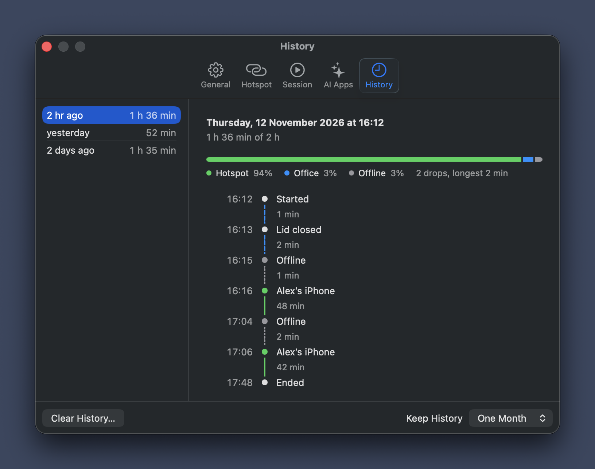

<p align="center">
  
</p>

<h1 align="center">Sleepwalk</h1>

<h3 align="center">Leave the office. Your Mac keeps working.</h3>

<p align="center">
  Close the lid, put your Mac in your backpack and turn on your iPhone’s hotspot.<br>
  Sleepwalk keeps the Mac awake and online.
</p>

<p align="center">
  <a href="https://github.com/neothic/sleepwalk/releases/latest"></a><br>
  <sub>Free · macOS 14 or later</sub>
</p>

<p align="center">
  
</p>

## How it works

1. **Start a session** from the menu bar.
2. **Close the lid.** The Mac stays awake.
3. **Turn on Personal Hotspot** on your iPhone. Sleepwalk keeps the Mac connected to it.

Useful for AI coding agents on the commute, long builds and test runs, and uploads.

## Features

- Awake with the lid closed
- Reconnects to your iPhone’s hotspot
- Stays on the hotspot instead of other Wi-Fi
- Remote desktop and screen recording with the lid closed
- Mute, dim and lock on lid close
- Low Power Mode with the lid closed
- Session end on low battery or heat
- Session history
- Keyboard shortcut, Siri, Spotlight and command line

## Setup

### Manual

1. [Download Sleepwalk](https://github.com/neothic/sleepwalk/releases/latest), move it to Applications and open it.
2. In **Settings → General**, click **Grant**.
3. In **Settings → Hotspot**, enter the hotspot name and password.

### With an AI agent

Also connects the agent to Sleepwalk. Paste this into Claude Code or Codex; it does not work in a normal chat.

```text
Install and set up Sleepwalk (https://github.com/neothic/sleepwalk) on this Mac. Run the commands yourself and keep every reply to one or two lines. If you have no shell on this Mac (`spctl` is missing), stop and tell me to use Claude Code or Codex. You will run an app you just downloaded: if that needs my approval, ask me once before step 3.

1. Download the .zip from https://github.com/neothic/sleepwalk/releases/latest and unpack it with `ditto -x -k`.
2. `spctl --assess --type execute -v Sleepwalk.app` must report "Notarized Developer ID" and `codesign -dv Sleepwalk.app` must show TeamIdentifier=2H5DY5334C. Stop if either differs.
3. Move Sleepwalk.app to /Applications and open it.
4. Add `/Applications/Sleepwalk.app/Contents/MacOS/Sleepwalk mcp` as an MCP server to your own configuration, for every project.
5. Ask me one thing: the name of my iPhone's hotspot. Run `/Applications/Sleepwalk.app/Contents/MacOS/Sleepwalk set hotspot <name>`, writing ’ for any apostrophe.
6. Run `/Applications/Sleepwalk.app/Contents/MacOS/Sleepwalk grant-permission`; macOS asks me for my Mac password.
7. Run `/Applications/Sleepwalk.app/Contents/MacOS/Sleepwalk status`. When it says "Permission: granted", finish with one line: enter the hotspot password in Sleepwalk's Settings → Hotspot.
```

## AI connector

Sleepwalk is an MCP server, so an AI app can start and end sessions itself.

Connect Claude, Codex, Cursor or Visual Studio Code in **Settings → AI Apps**.

<details>
<summary>Any other app</summary>

```json
{
  "mcpServers": {
    "sleepwalk": { "command": "/Applications/Sleepwalk.app/Contents/MacOS/Sleepwalk", "args": ["mcp"] }
  }
}
```
</details>

## Questions

**Is it safe to keep a closed Mac in a bag?**

It can get hot. Sleepwalk ends the session when macOS reports heat, but it can’t prevent overheating, so leave some airflow around your Mac.

**Why does it ask for an administrator password?**

Keeping a closed Mac awake is a system setting, and changing it needs an administrator. Sleepwalk asks once.

**How do I remove it?**

Settings → General → Uninstall.

## Feedback

Found a bug or missing something?
[Open an issue](https://github.com/neothic/sleepwalk/issues/new).

<p align="center">
  <sub>This repository holds releases only. Use of Sleepwalk is subject to the <a href="LICENSE">licence</a>.<br>© <a href="https://neothic.com">Neothic d.o.o.</a></sub>
</p>
